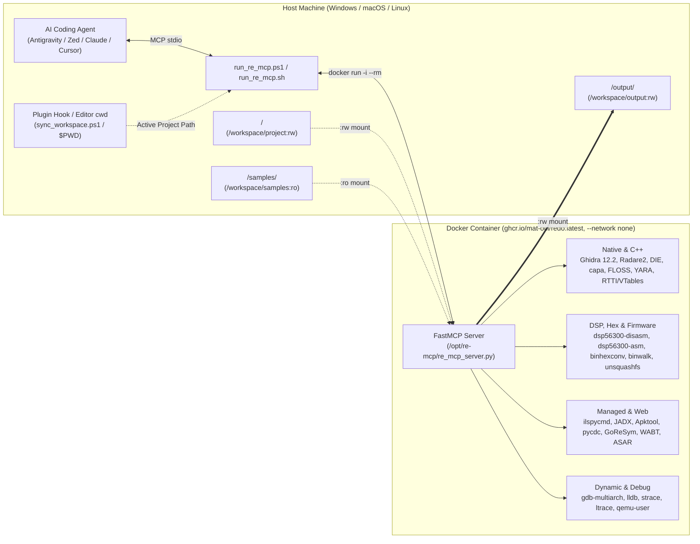

# redo: Containerized Reverse Engineering & DSP MCP Toolkit

[](https://github.com/mat-ocl/redo/actions/workflows/docker-image.yml)

**`redo`** (`ghcr.io/mat-ocl/redo:latest`) is a hardened, air-gapped Docker environment and **Model Context Protocol (MCP)** server (`re_mcp_server.py`) that equips AI coding agents (Antigravity, Zed, Claude Code, Cursor, Windsurf, VS Code) and human analysts with **50 specialized reverse-engineering, binary triage, decompilation, hex conversion, and DSP analysis tools**.

---

## Key Features

- **Air-Gapped & Privilege-Dropped Execution**: Runs with `--network none`, `cap_drop: ALL`, `no-new-privileges:true`, a read-only `/workspace/samples` mount, and drops root privileges to unprivileged user `ubuntu` (`UID 1000`) via `gosu`.
- **50 Turnkey MCP Tools**: Unified FastMCP server (`re_mcp_server.py`) covering Native PE/ELF/Mach-O, C++ RTTI/VTables, **Motorola DSP56300** 24-bit DSP ROMs, Binary/Hex-Text inspection & conversion (`BinHexConv`), .NET/C#, Android APK/DEX, Python/PyInstaller, Go, WebAssembly, Electron ASAR/JS, Firmware/Installers, and Dynamic Tracing.
- **Persistent Ghidra 12.2 Headless Cache**: Automatically fingerprints binaries into `<project>/output/ghidra_cache/` so subsequent `ghidra_decompile_function` calls execute in ~3–5 seconds, plus a `fast_mode=True` option that decompiles functions in 20MB+ C++ binaries in ~8 seconds without waiting for full-program auto-analysis.
- **Motorola DSP56300 Toolchain (`dsp56300-disasm` & `dsp56300-asm`)**: Native support for disassembling and assembling 24-bit Motorola/Freescale/NXP DSP56300 code (`u24be`, `u24le`, `u32le`, `u32be`, `u24be_swap16`) including direct byte-offset slicing from larger firmware or host binaries.
- **LLM-Friendly Binary Hex Inspection & Conversion (`BinHexConv` / `bin2hext`)**: Built-in `binary_hex_dump` (with wildcard hex pattern search `F0 43 ??`, canonical hex+ASCII, and `u24be` 24-bit DSP word tables) and `binary_hex_convert` (powered by [`mat-ocl/binhexconv`](https://github.com/mat-ocl/binhexconv)) for converting binary/SysEx/ROM files to hexadecimal text and back.
- **Automatic Per-Project Folder Mapping**: When enabled on a project (via Antigravity's `SessionStart`/`PreInvocation` plugin hook or per-project working directory in Zed, Cursor, VS Code, Windsurf, and Claude Code), `run_re_mcp.ps1` mounts **only** that active project's folders (`<Project>/samples` &rarr; `/workspace/samples:ro`, `<Project>/output` &rarr; `/workspace/output:rw`, `<Project>` &rarr; `/workspace/project:rw`) into the container.
- **Zero-Rebuild MCP Iteration**: `re_mcp_server.py` is bind-mounted into `/opt/re-mcp/re_mcp_server.py:ro` at runtime, so adding or modifying MCP tools on the host takes effect immediately without rebuilding the Docker image.

---

## Architecture Overview



---

## Quick Start & Installation

You can install and run **`redo`** in two ways:
1. **Zero-Clone Mode (For AI Agents & Direct Docker Setup)**: Pull the pre-built image from GHCR (or build directly from the GitHub URL) and run `re-mcp-server` straight from the container image—**no `git clone` or local scripts on disk required**.
2. **Local Repository / Plugin Mode (Recommended)**: Run `install_plugin.ps1` / `install_zed.ps1` to install the self-contained plugin and workspace hooks that automatically mount whichever project you open.

---

### Method 1: Zero-Clone Installation (For AI Agents — No `git clone` Required)

Because `re_mcp_server.py` is baked directly into `/opt/re-mcp/re_mcp_server.py` (with an unbuffered wrapper at `/usr/local/bin/re-mcp-server`) inside the Docker image, an AI agent can install the entire toolkit directly from the GitHub URL without cloning the repository:

#### Step 1: Pull the Pre-Built GHCR Image (Fastest) or Build Directly from GitHub
```bash
# Option A: Pull the pre-built image from GitHub Container Registry (GHCR):
docker pull ghcr.io/mat-ocl/redo:latest

# Option B: Or build directly from the remote GitHub URL (no local git clone needed):
docker build --target final -t ghcr.io/mat-ocl/redo:latest https://github.com/mat-ocl/redo.git
```

#### Step 2: Configure Your Editor / MCP Client (Zero-Clone Direct Docker)
Mount your project directory (e.g. `D:/Code/my-project` on Windows or `/home/user/my-project` on Linux) to `/workspace/project:rw` (plus its `samples` and `output` folders) and set `RE_PROJECT_ROOT` to match:

- **Zed Editor (`.zed/settings.json` in your project or `%APPDATA%\Zed\settings.json`):**
  ```json
  {
    "context_servers": {
      "redo": {
        "source": "custom",
        "command": "C:/Program Files/Docker/Docker/resources/bin/docker.exe",
        "args": [
          "run", "-i", "--rm",
          "--network", "none",
          "--cap-drop", "ALL",
          "--cap-add", "CHOWN",
          "--cap-add", "DAC_OVERRIDE",
          "--cap-add", "SETUID",
          "--cap-add", "SETGID",
          "--cap-add", "SYS_PTRACE",
          "--security-opt", "seccomp=unconfined",
          "--security-opt", "no-new-privileges:true",
          "-e", "PYTHONUNBUFFERED=1",
          "-e", "RE_PROJECT_ROOT=D:/Code/my-project",
          "-v", "D:/Code/my-project/samples:/workspace/samples:ro",
          "-v", "D:/Code/my-project/output:/workspace/output:rw",
          "-v", "D:/Code/my-project:/workspace/project:rw",
          "ghcr.io/mat-ocl/redo:latest",
          "re-mcp-server"
        ],
        "env": {}
      }
    }
  }
  ```

- **Google Antigravity / Claude Desktop / Cursor / Windsurf (`mcp_config.json` / `.cursor/mcp.json`):**
  ```json
  {
    "mcpServers": {
      "redo": {
        "command": "docker",
        "args": [
          "run", "-i", "--rm",
          "--network", "none",
          "--cap-drop", "ALL",
          "--cap-add", "CHOWN",
          "--cap-add", "DAC_OVERRIDE",
          "--cap-add", "SETUID",
          "--cap-add", "SETGID",
          "--cap-add", "SYS_PTRACE",
          "--security-opt", "seccomp=unconfined",
          "--security-opt", "no-new-privileges:true",
          "-e", "PYTHONUNBUFFERED=1",
          "-e", "RE_PROJECT_ROOT=D:/Code/my-project",
          "-v", "D:/Code/my-project/samples:/workspace/samples:ro",
          "-v", "D:/Code/my-project/output:/workspace/output:rw",
          "-v", "D:/Code/my-project:/workspace/project:rw",
          "ghcr.io/mat-ocl/redo:latest",
          "re-mcp-server"
        ]
      }
    }
  }
  ```

---

### Method 2: Local Clone Installation

#### 1. Prerequisites
- **Docker Desktop** (Windows/macOS) or **Docker Engine** (Linux) with Docker Compose v2.
- **PowerShell 7+** (`pwsh`) on Windows, or **Bash** on Linux/macOS/WSL.

#### 2. Run the One-Command Installer (Pulls Pre-Built GHCR Image Automatically)
From PowerShell inside the cloned repository directory (even if cloned into a temporary `scratch` or `/tmp` directory):

```powershell
# Pulls pre-built ghcr.io/mat-ocl/redo:latest (if needed) and installs the self-contained Antigravity & Zed plugins:
.\install_plugin.ps1

# Optional: Also copy .agents rules & skills into your active project workspace at the same time:
.\install_plugin.ps1 -TargetWorkspace "D:\Code\my-project"
```

*(Only pass `.\install_plugin.ps1 -BuildImage` if you modified `Dockerfile` and want to recompile the 4-stage image locally from scratch instead of pulling `ghcr.io/mat-ocl/redo:latest`).*

> [!TIP]
> **Self-Contained Scratch Clone Support**: `install_plugin.ps1` copies `run_re_mcp.ps1`, `re_mcp_server.py`, `uninstall_plugin.ps1`, `hooks.json`, and `sync_workspace.ps1` directly into `~/.gemini/config/plugins/redo/`. If an AI agent clones this repository into a temporary `scratch` folder to run `.\install_plugin.ps1`, it does **not** need to clone the repository a second time.

### Uninstalling

To remove the Antigravity plugin (`~/.gemini/config/plugins/redo`), clean up Zed's `context_servers.redo` entry, and stop any running `redo` containers:

```powershell
# From the repository:
.\install_plugin.ps1 -Uninstall

# Or from anywhere (even if the repository clone was deleted):
& "$HOME\.gemini\config\plugins\redo\uninstall_plugin.ps1"

# Also delete the ~4.3 GB local Docker image (ghcr.io/mat-ocl/redo:latest):
.\install_plugin.ps1 -Uninstall -RemoveImage
```

### 3. Configure MCP Clients

#### A. Google Antigravity IDE
Running `.\install_plugin.ps1` automatically installs the `redo` plugin (including its MCP config, `hooks.json` workspace sync hook, agent rules, and `reverse-engineering` / `install-redo` skills) into `~/.gemini/config/plugins/redo`. You can toggle it on or off anytime from the Antigravity Plugins panel (`customization://redo`).

#### B. Zed Editor (Turnkey Installation)
This repository includes a dedicated installer and workspace configuration for **Zed Editor**:

- **Project-Local Configuration ([`.zed/settings.json`](./.zed/settings.json) & [`AGENTS.md`](./AGENTS.md))**: Opening this repository in Zed automatically registers the `redo` context server and loads [`AGENTS.md`](./AGENTS.md) into Zed's Agent Panel.
- **Global Zed Installation (`%APPDATA%\Zed\settings.json` on Windows / `~/.config/zed/settings.json` on Linux & macOS)**:
  Run the dedicated Zed installer script to non-destructively merge `redo` into your global Zed `context_servers` (while preserving your existing JSONC comments and settings):

  ```powershell
  # Windows (PowerShell) - uses run_re_mcp.ps1 launcher (recommended for multi-project support):
  .\install_zed.ps1

  # Or configure Zed to invoke docker.exe directly + append RE rules to global %APPDATA%\Zed\AGENTS.md:
  .\install_zed.ps1 -Mode docker -InstallGlobalRules
  ```

  ```bash
  # Linux / macOS / WSL:
  ./install_zed.sh
  ```

  **Manual Zed `settings.json` (`context_servers`) snippet:**
  ```json
  {
    "context_servers": {
      "redo": {
        "source": "custom",
        "command": "pwsh",
        "args": [
          "-NoProfile",
          "-NonInteractive",
          "-ExecutionPolicy",
          "Bypass",
          "-File",
          "C:/path/to/redo/run_re_mcp.ps1"
        ],
        "env": {}
      }
    }
  }
  ```

#### C. Claude Desktop / Cursor / Windsurf / VS Code
Add the following entry to your MCP configuration file (`claude_desktop_config.json`, `.cursor/mcp.json`, or `mcp_config.json`):

**Windows (PowerShell):**
```json
{
  "mcpServers": {
    "redo": {
      "command": "pwsh",
      "args": [
        "-NoProfile",
        "-NonInteractive",
        "-ExecutionPolicy",
        "Bypass",
        "-File",
        "C:/path/to/redo/run_re_mcp.ps1"
      ]
    }
  }
}
```

**Linux / macOS / WSL (Bash):**
```json
{
  "mcpServers": {
    "redo": {
      "command": "/bin/bash",
      "args": [
        "/path/to/redo/run_re_mcp.sh"
      ]
    }
  }
}
```

---

## Complete MCP Tool Reference (50 Tools)

### 1. Workspace, File Staging & Binary/Hex-Text Conversion
| MCP Tool | Description |
| :--- | :--- |
| `list_workspace_files` | List files in the active project (`/workspace/project`), `samples/`, `output/`, or a relative subfolder. |
| `read_workspace_file` | Read line ranges from decompiled source files (`.c`, `.java`, `.cs`, `.py`, `.asm`, `.js`) with line numbers. |
| `search_workspace_files` | Regex search across all decompiled or extracted files in `output/`. |
| `stage_file_from_base64` | Upload a binary or archive directly into the sandbox over MCP via Base64. |
| `stage_text_file` | Write custom scripts, YARA rules, DSP56300 assembly, or Ghidra post-scripts into the workspace. |
| `binary_hex_dump` | Inspect binary slices (`[byte_offset, byte_length]`) in LLM-friendly formats (`canonical` hex+ASCII, `u24be` 24-bit DSP words, `u16le`/`u32le`, `spaced`, `raw`, `c_array`) with wildcard hex pattern search (`F0 43 ??`). |
| `binary_hex_convert` | Bidirectional Binary &harr; Hexadecimal text converter powered by [`binhexconv`](https://github.com/mat-ocl/binhexconv) (`bin2hext -b/-h`) and whitespace-tolerant hex decoding. |

### 2. Initial Triage, Headers, Entropy & Packer Detection
| MCP Tool | Underlying Engine | Description |
| :--- | :--- | :--- |
| `file_triage` | `file`, `diec`, `upx`, Python | Universal initial triage: hashes (MD5/SHA256), Shannon entropy, UPX check, DIE compiler/packer summary, and ecosystem detection. |
| `diec_detect` | Detect-It-Easy (`diec` 3.21) | Deep compiler, linker, protector (VMProtect, Themida, UPX), and section entropy scan. |
| `pe_elf_headers` | `pefile`, `pyelftools`, `rabin2`, `osslsigncode` | Inspect PE/ELF sections with Shannon entropy, exports, TLS callbacks, PE resource tables, overlays, and Authenticode signatures. |
| `yara_scan` | `yara` + DIE & Community Rules | Scan binaries against built-in rule packs (`all_die`, `peid`, `packer`, `crypto`, `malware`, `community_packers`, `community_crypto`) or custom `.yar` files. |
| `capa_detect_capabilities` | Mandiant `capa` 10.0.0 | Identify program capabilities mapped to MITRE ATT&CK and MBC with function addresses. |
| `floss_extract_strings` | Mandiant `floss` | Recover obfuscated stack strings, tight strings, decoded strings, and static strings. |

### 3. C++ RTTI/VTables & Motorola DSP56300
| MCP Tool | Underlying Engine | Description |
| :--- | :--- | :--- |
| `cpp_rtti_and_vtables` | Custom MSVC RTTI Parser / `r2` | Recover MSVC & Itanium C++ class names, full multiple-inheritance hierarchies, and VTable virtual addresses (`vtable_vaddr` + `first_method_vaddr`). |
| `dsp56300_disassemble` | `dsp56300-disasm` | Disassemble Motorola DSP56300 24-bit program memory (`u24be`, `u24le`, `u32le`, `u32be`, `u24be_swap16`) with start address (`-s`), instruction count (`-n`), and embedded binary slicing (`byte_offset`/`byte_length`). |
| `dsp56300_assemble` | `dsp56300-asm` | Assemble Motorola DSP56300 assembly files or inline assembly strings into `u24be`, `u24le`, `u32le`, or `.lod` format. |

### 4. Native Disassembly & Decompilation (Radare2 & Ghidra 12.2 Headless)
| MCP Tool | Underlying Engine | Description |
| :--- | :--- | :--- |
| `ghidra_decompile_function` | Ghidra 12.2 Headless | Decompile a single function (by name or hex address) into C pseudocode. Uses persistent project caching and supports `fast_mode=True` (~8s on large C++ binaries). |
| `ghidra_list_functions` | Ghidra 12.2 Headless | List discovered functions, sizes, and C prototypes from the cached Ghidra project. |
| `ghidra_decompile_all` | Ghidra 12.2 Headless | Decompile all non-thunk functions in a binary into a single searchable `.c` file in `output/`. |
| `ghidra_headless_analyze` | Ghidra 12.2 Headless | Run custom Ghidra headless analysis with optional `-processor` (e.g. `DSP56300:BE:24:default`), `-loader`, `-baseAddr`, and custom Java/Python post-scripts. |
| `r2_binary_info` | `rabin2 -I -j` | Architecture, endianness, relocations, and binary security mitigations. |
| `r2_imports_exports_sections` | `rabin2 -S -i -E` | List sections, imported APIs, and exported functions. |
| `r2_strings` | `rabin2 -z / -zz` | Extract strings with virtual addresses and regex filtering. |
| `r2_list_functions` | `r2` (`aa` / `aaa; afl`) | List functions with configurable analysis depth (`aa` for fast C++ symbol/call scan, `aaa` for full analysis). |
| `r2_xrefs` | `r2` (`axt` / `axf`) | Find cross-references TO and FROM any function or address. |
| `r2_callgraph` | `r2` (`agcj`) | Extract JSON caller/callee callgraph for a target function. |
| `r2_disassemble_function` | `r2` (`af; pdf`) | Fast targeted assembly listing for any function or VTable method address. |
| `r2_decompile_function` | `r2` (`pdc`) | Quick C-like pseudocode generation via Radare2. |

### 5. Managed Runtimes, Bytecode, WebAssembly & Electron
| MCP Tool | Underlying Engine | Description |
| :--- | :--- | :--- |
| `dotnet_list_types` | `ilspycmd` 11.2 | List all namespaces, classes, interfaces, structs, and enums in a .NET assembly. |
| `dotnet_decompile` | `ilspycmd` 11.2 | Decompile a specific .NET class or dump an entire C# Visual Studio project to `output/`. |
| `jadx_extract_manifest` | `jadx` 1.5.6 | Decode `AndroidManifest.xml` from an APK. |
| `jadx_list_classes` | `jadx` 1.5.6 | Decompile APK/DEX/JAR (cached in `output/`) and list all Java/Kotlin classes. |
| `jadx_decompile_class` | `jadx` 1.5.6 | Return decompiled Java source for a single class FQN. |
| `jadx_decompile_all_and_search` | `jadx` 1.5.6 | Decompile entire APK/DEX/JAR and regex-search across all Java/XML sources. |
| `apktool_decode` | `apktool` 3.0.3 | Decode APK resources and Smali disassembly into `output/`. |
| `pyinstaller_extract_and_decompile` | `pyinstxtractor-ng` + `pycdc` | Unpack PyInstaller executables and automatically decompile entrypoint `.pyc` files. |
| `pyc_decompile` | `pycdc` / `pycdas` | Decompile Python `.pyc` bytecode to Python source (with `pycdas` bytecode fallback). |
| `go_extract_symbols` | Mandiant `GoReSym` 3.4.1 | Recover Go compiler metadata, package paths, user function addresses, and struct types from stripped Go binaries. |
| `wasm_decompile` | WABT (`wasm-decompile`, `wasm2wat`, `wasm-objdump`) | Decompile `.wasm` binaries into C-like pseudocode, WAT text format, or section headers. |
| `asar_list` / `asar_extract` | `@electron/asar` | Inspect or extract Electron `.asar` application bundles. |
| `js_beautify_file` / `js_deobfuscate` | `js-beautify`, `synchrony`, `deobfuscator` | Format minified JavaScript or deobfuscate packed JS bundles. |
| `rea_analyze` | `@morluto/rea` | Static analysis summary for scripts and application directories. |

### 6. Archives, Firmware & Dynamic Tracing
| MCP Tool | Underlying Engine | Description |
| :--- | :--- | :--- |
| `archive_list` / `archive_extract` | `7z`, `innoextract`, `unsquashfs` | List or extract `.zip`, `.7z`, `.rar`, `.msi`, `.cab`, `.iso`, InnoSetup `.exe`, NSIS `.exe`, and SquashFS images. |
| `binwalk_scan` | `binwalk` | Scan firmware/binaries for embedded filesystems and optionally carve them into `output/`. |
| `upx_unpack` | `upx` | Unpack UPX-compressed PE/ELF binaries into `output/`. |
| `dynamic_trace_syscalls` | `strace`, `ltrace`, `qemu-user` | Trace syscalls or library calls of ELF binaries (including cross-arch ARM/AArch64/MIPS via QEMU user-mode). |
| `gdb_analyze` | `gdb-multiarch`, `lldb` | Execute non-interactive batch debugger commands (`info functions`, `disassemble`, memory dumps). |

---

## Working with Motorola DSP56300 Firmware & DSP Binaries

The container includes the Rust-based **`dsp56300-disasm`** and **`dsp56300-asm`** tools from [`xemu-project/dsp56300`](https://github.com/xemu-project/dsp56300), exposed both as CLI commands inside the container and as MCP tools (`dsp56300_disassemble` and `dsp56300_assemble`).

### Word Formats Supported by `dsp56300_disassemble`
Motorola DSP56300 uses 24-bit instruction words in Program (`P:`) memory. Depending on how a ROM or firmware image was dumped, words may be stored in several layouts:

- **`u24be` (Default)**: Native 3 bytes per word, big-endian (`[MSB, MID, LSB]`). Standard for raw DSP56300 ROM dumps and firmware payloads.
- **`u24le`**: 3 bytes per word, little-endian (`[LSB, MID, MSB]`).
- **`u32le`**: 4 bytes per word, little-endian (`[LSB, MID, MSB, 0x00]`). Default format of the standalone `dsp56300-disasm` CLI.
- **`u32be`**: 4 bytes per word, big-endian (`[0x00, MSB, MID, LSB]`). Automatically converted to `u24be` by the MCP server.
- **`u24be_swap16`**: 16-bit byte-swapped EPROM dumps (`[B1, B0, B3, B2, ...]`). Automatically unswapped before disassembly.

### Disassembling Embedded DSP Code Inside a Larger Binary
Often, a firmware update or host binary embeds a DSP56300 program block at a specific byte offset. You do **not** need to manually carve the file first—pass `byte_offset` and `byte_length` directly to `dsp56300_disassemble`:

```python
# Example MCP tool call:
dsp56300_disassemble(
    file_path="samples/firmware.bin",
    word_format="u24be",
    start_addr="0x0100",
    byte_offset=0x14800,
    byte_length=0x6000,
    save_output=True,
    output_filename="dsp_routine.asm"
)
```

---

## Binary Hex Inspection & Conversion (`BinHexConv`)

LLMs cannot reliably read raw binary files (`.bin`, `.rom`, `.syx`) using standard text file readers without corrupting non-ASCII bytes. **`redo`** includes [`mat-ocl/binhexconv`](https://github.com/mat-ocl/binhexconv) (`bin2hext`) and two dedicated MCP tools for binary-to-hex analysis:

- **`binary_hex_dump`**: Inspect any `[byte_offset, byte_length]` window of a binary file in `canonical` (`hexdump -C` offset + hex + ASCII), `u24be` (24-bit DSP56300 word tables with `P:$xxxx` addresses), `spaced`, `raw`, or `c_array` format, and search for wildcard byte patterns (e.g., `search_hex_pattern="F0 43 ?? 00"` for MIDI SysEx headers).
- **`binary_hex_convert`**: Convert entire binary files or slices into hexadecimal text files in `output/` (`direction="bin_to_hex"`) and reconstruct binary files from edited hex text (`direction="hex_to_bin"`, automatically stripping whitespace, newlines, or `0x` prefixes).

---

## Interactive CLI Usage (Docker Compose Profiles)

In addition to headless MCP operation, you can drop into an interactive Bash shell inside the sandbox using two preconfigured profiles in [`compose.yml`](./compose.yml):

### 1. Static Analysis Profile (Air-Gapped, Read-Only Root)
```bash
docker compose --profile static run --rm re-static
```

### 2. Dynamic Analysis Profile (`SYS_PTRACE` Enabled, Isolated Internal Bridge)
```bash
docker compose --profile dynamic run --rm re-dynamic
```

### Built-In Shell Aliases & Functions (`re_aliases.sh`)
Inside the interactive container shell, the following shortcuts are preloaded in `~/.bashrc`:
- `r2` &rarr; `r2 -e bin.relocs.apply=true -q`
- `die-scan <file>` &rarr; `diec -d -e <file>`
- `capa-scan <file>` &rarr; `capa -r /opt/capa/rules <file>`
- `yara-peid <file>` / `yara-packers <file>` / `yara-crypto <file>`
- `dsp563-dis <rom.bin>` &rarr; `dsp56300-disasm -f u24be <rom.bin>`
- `dsp563-dump <rom.bin> [u24be|u24le|u32le] [start_addr]` &rarr; Disassembles to `<rom>_dsp56300.asm`
- `ghidra-analyze <proj_dir> <proj_name> <binary>`
- `dotnet-dump <assembly.dll>` &rarr; Decompiles C# project via `ilspycmd`
- `jadx-dump <app.apk>` &rarr; Decompiles APK via `jadx`
- `floss-clean <binary>` &rarr; Extracts obfuscated strings only
- `goresym-dump <go_binary>` &rarr; Recovers Go symbols and types
- `bin2hex <input.bin> [output.hex]` / `hex2bin <input.hex> [output.bin]` &rarr; Converts binary files to hex text and back via `bin2hext` (`binhexconv`)

---

## Per-Project Container Isolation & Automatic Path Resolution

Unlike single-container MCP wrappers that freeze volume mounts at IDE startup, `run_re_mcp.ps1` and `run_re_mcp.sh` act as a **host-side MCP JSON-RPC multiplexer** that dynamically spawns and manages an **isolated Docker container per project root on demand**:
1. `<ProjectDir>/samples` &rarr; `/workspace/samples:ro`
2. `<ProjectDir>/output` &rarr; `/workspace/output:rw`
3. `<ProjectDir>` &rarr; `/workspace/project:rw`

How per-project routing and path resolution work across simultaneous projects:
- **Explicit Host Paths**: When an agent passes any host path (`C:/CODE/ProjectA/samples/foo.dll` or `D:/Projects/ProjectB/rom.bin`), the multiplexer automatically detects the enclosing project root (via registered workspaces or project markers like `.git`, `.agents`, `.zed`, `.vscode`, `CMakeLists.txt`), spawns or reuses the container dedicated exclusively to that project, and routes the tool call to it.
- **Relative Project Paths (`samples/foo.bin`, `"M3 Plug-In Editor.dll"`, or empty `list_workspace_files({})`)**:
  - **Google Antigravity**: The bundled lifecycle hook (`plugin/redo/hooks.json` &rarr; `sync_workspace.ps1`) fires on `SessionStart`, `PreInvocation`, and synchronously on `PreToolUse` right before every tool call, recording each conversation's workspace in `workspaces/<conversationId>.json`. The multiplexer checks open workspaces for matching relative files first and falls back to the active conversation's workspace—rewriting relative paths to full project paths and routing them to that project's isolated container automatically.
  - **Zed Editor, Cursor, VS Code, Windsurf, and Claude Code**: Spawn the MCP server process with its working directory (`$PWD` / `Get-Location`) set to the open project root, which `run_re_mcp.ps1` and `run_re_mcp.sh` detect automatically.

---

## Repository Structure

```text
.
├── .github/
│   └── workflows/
│       └── docker-image.yml    # GitHub Actions CI/CD workflow (builds, smoke-tests & publishes to GHCR on v* tags)
├── Dockerfile                  # 4-stage Ubuntu 24.04 container build (includes dsp56300-disasm & binhexconv)
├── compose.yml                 # Hardened 'static' and 'dynamic' Docker Compose profiles
├── re_mcp_server.py            # FastMCP server exposing 50 reverse-engineering, hex & DSP tools
├── run_re_mcp.ps1              # Per-project Windows PowerShell MCP JSON-RPC container multiplexer
├── run_re_mcp.sh               # Per-project Linux / macOS / WSL MCP JSON-RPC container multiplexer
├── install_plugin.ps1          # One-command installer / uninstaller for Antigravity, Zed & Docker
├── uninstall_plugin.ps1        # Standalone uninstaller (also copied into ~/.gemini/config/plugins/redo/)
├── install_zed.ps1             # Dedicated Zed Editor installer (updates %APPDATA%\Zed\settings.json & .zed/settings.json)
├── install_zed.sh              # Dedicated Zed Editor installer for Linux / macOS
├── entrypoint.sh               # Container entrypoint (privilege drop via gosu ubuntu)
├── re_aliases.sh               # Interactive shell aliases and helper functions
├── AGENTS.md                   # Root-level instructions for AI coding agents (Zed, Antigravity, Cursor, Claude)
├── .zed/
│   └── settings.json           # Workspace-local Zed Editor context_servers configuration
├── samples/                    # Default read-only input directory (.gitkeep)
├── output/                     # Default read-write output directory (.gitkeep)
├── plugin/
│   └── redo/                   # Distributable Antigravity plugin bundle (includes hooks.json & sync_workspace.ps1)
└── .agents/
    ├── rules/
    │   └── AGENTS.md           # Workspace agent rules for binary, hex & DSP analysis
    └── skills/
        ├── install-redo/       # Agent skill for autonomous installation & setup
        └── reverse-engineering/# Workflow skill for redo MCP server
```
